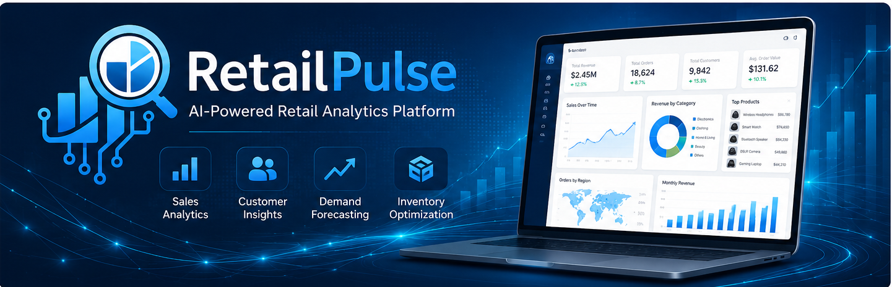
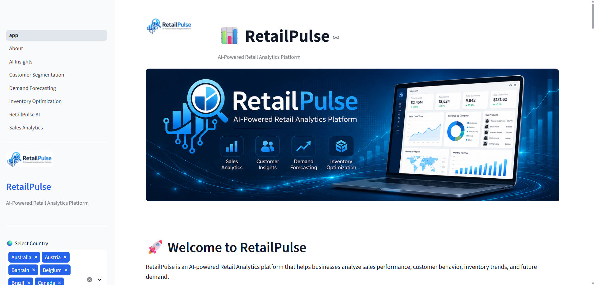
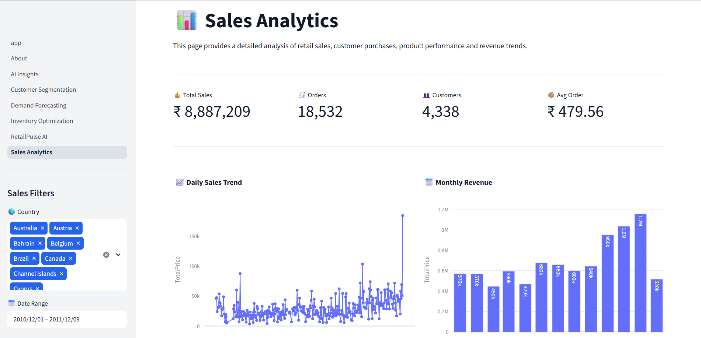
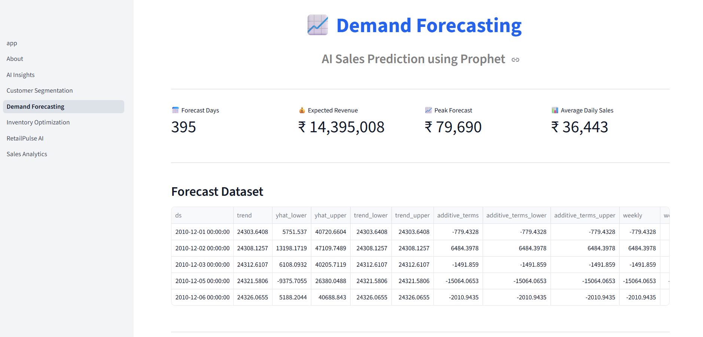
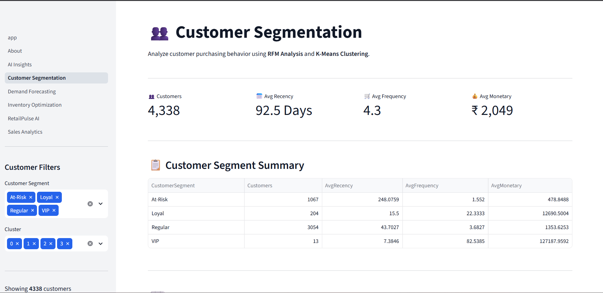
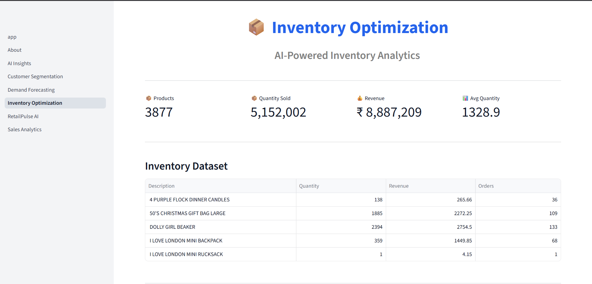
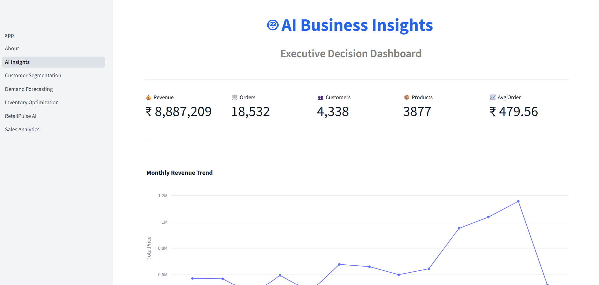

<p align="center">
  
</p>

<h1 align="center">📊 RetailPulse</h1>

<p align="center">
AI-Powered Retail Analytics Platform built using Machine Learning, Streamlit and Python
</p>

<p align="center">


</p>

---

# 📌 Overview

RetailPulse is an AI-powered retail analytics platform that enables businesses to analyze retail transactions, customer purchasing behavior, demand forecasting, and inventory optimization through an interactive dashboard.

The project combines **Data Analytics**, **Machine Learning**, and **Business Intelligence** into one platform.

---

# ✨ Features

- 📊 Sales Analytics Dashboard
- 👥 Customer Segmentation
- 📈 Demand Forecasting
- 📦 Inventory Optimization
- 🤖 AI Business Insights
- 🌍 Country-wise Revenue Analysis
- 📉 Daily & Monthly Sales Trends
- 👑 Top Customers
- 🛍 Top Selling Products
- 📄 Download Reports

---

# 🛠 Tech Stack

| Category | Technologies |
|----------|--------------|
| Language | Python |
| Dashboard | Streamlit |
| Data Analysis | Pandas, NumPy |
| Visualization | Plotly |
| Machine Learning | Scikit-learn |
| Forecasting | Prophet |
| Prediction | XGBoost |

---

# 📸 Project Screenshots

## 🏠 Home Dashboard



---

## 📊 Sales Analytics



---

## 📈 Demand Forecasting



---

## 👥 Customer Segmentation



---

## 📦 Inventory Optimization



---

## 🤖 AI Business Insights



---

# 📂 Project Structure

```text
RetailPulse/
│
├── app.py
├── assets/
├── data/
├── notebooks/
├── pages/
├── screenshots/
├── requirements.txt
├── README.md
└── .gitignore
```

---

# 🚀 Installation

Clone the repository

```bash
git clone https://github.com/kuldeep2913/RetailPulse.git
```

Go to project

```bash
cd RetailPulse
```

Create virtual environment

```bash
python -m venv venv
```

Activate

Windows

```bash
venv\Scripts\activate
```

Install dependencies

```bash
pip install -r requirements.txt
```

Run Streamlit

```bash
streamlit run app.py
```

---

# 📊 Dashboard Modules

✅ Home

✅ Sales Analytics

✅ Customer Segmentation

✅ Demand Forecasting

✅ Inventory Optimization

✅ AI Insights

---

# 📈 Machine Learning Models

- Customer Segmentation
- Demand Forecasting
- Business Recommendation Engine

---

# 📌 Future Improvements

- User Authentication
- Real-time Dashboard
- Cloud Database
- Email Reports
- Chatbot Assistant
- REST API
- Mobile Friendly UI

---

# 👨‍💻 Developer

**Kuldeep Yadav**

B.Tech Computer Science Engineering (AI)

Shivalik College of Engineering

GitHub

https://github.com/kuldeep2913

---

# ⭐ Support

If you like this project, please give it a ⭐ on GitHub.
